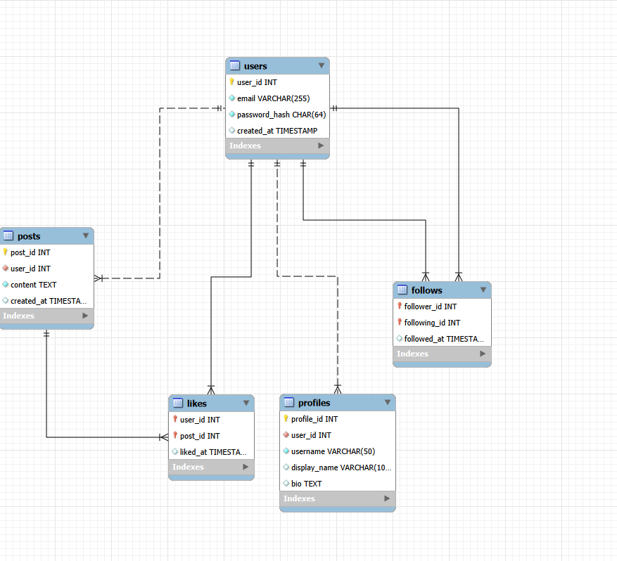
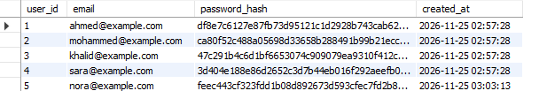
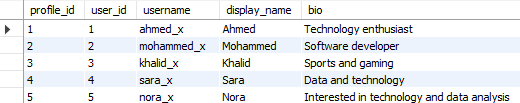
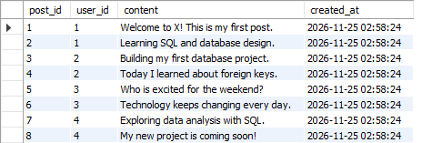
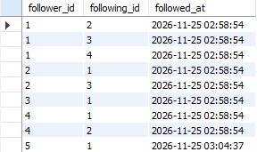
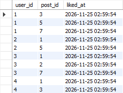

# X Database Management System

A relational database project built with MySQL that simulates core features of the X (formerly Twitter) platform.

## Project Overview

This project demonstrates how to design, build, and query a relational database for a social media platform. It covers user accounts, profiles, posts, followers, and likes.

## Database Schema

The database consists of five tables:

- **users:** Stores user account information.
- **profiles:** Stores usernames and profile details.
- **posts:** Stores user publications.
- **follows:** Manages follower-following relationships.
- **likes:** Records likes on posts.

## Entity Relationship Diagram



## Database Tables

### 1. Users Table


### 2. Profiles Table


### 3. Posts Table


### 4. Follows Table


### 5. Likes Table


The database uses the following relationships:

- Users and Profiles: One-to-One (1:1)
- Users and Posts: One-to-Many (1:N)
- Users and Users through Follows: Many-to-Many (M:N)
- Users and Posts through Likes: Many-to-Many (M:N)

## Data Analytics

The following query provides an overview of user engagement metrics, including total posts, followers, following, and likes received.


## Features

- Relational database design using MySQL.
- Primary keys and foreign key constraints.
- Data integrity using InnoDB and cascading deletes.
- Stored procedures for account creation and following users.
- SQL joins, aggregate functions, grouping, and subqueries.
- User engagement analytics, including posts, followers, following, and likes.

## Project Structure

```text
X-Database-Management-System/
│
├── database/
│   ├── 01_create_tables.sql
│   ├── 02_insert_sample_data.sql
│   ├── 03_stored_procedures.sql
│   ├── 04_analytics_queries.sql
│   └── 05_testing_queries.sql
│
├── screenshots/
│
└── README.md
```

## How to Run

Execute the SQL files in MySQL Workbench in the following order:

1. `01_create_tables.sql` – Create the database and tables.
2. `02_insert_sample_data.sql` – Insert sample data.
3. `03_stored_procedures.sql` – Create stored procedures.
4. `05_testing_queries.sql` – Test account creation and following functionality. Run this file only once on a fresh setup.
5. `04_analytics_queries.sql` – Run analytical queries.

**Note:** This project is intended for a fresh database setup. The testing script creates an additional sample account named `nora_x`.

## Technologies Used

- MySQL
- MySQL Workbench
- SQL

## Security Note

SHA2-256 is used for password hashing in this educational project. Production applications should use dedicated password-hashing algorithms such as Argon2id or bcrypt.

## Author

Osama Abdullah Alshehri

Computer Engineering Graduate | Data Analysis Enthusiast
